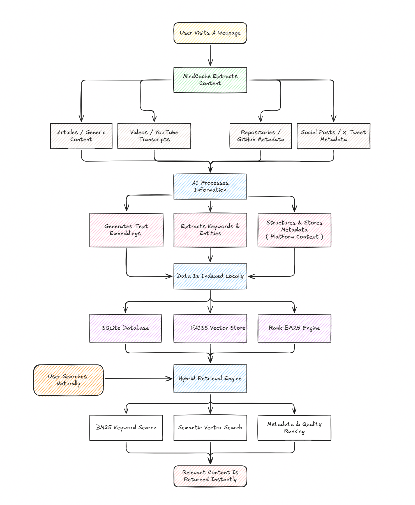

<p align="center">
  
</p>

# MindCache

> A personal browser memory assistant with a local backend and browser extension. MindCache saves and searches pages you choose to capture. Page extraction and model downloads can use the network.

---

## Quick Start

Install Python, [uv](https://docs.astral.sh/uv/), Node.js and npm, then run:

```bash
./setup.sh
./start.sh
```

Open `http://127.0.0.1:8000/app/` and load `extension/dist/` as an unpacked extension in Chrome or Brave. The bundled extension connects automatically. New installations start with automatic tracking off; existing saved settings are preserved. Run `./setup.sh --help` for build options. Setup installs the locked backend dependencies and extension packages; it requires network access for packages not already cached. It does not download an AI model deliberately.

Embeddings always use EmbeddingGemma 2 on your computer; download it once from the Models page. Text generation is optional: choose a local model, Ollama, or an OpenAI-compatible API with your own key (remote endpoints need explicit consent and HTTPS). Search falls back to lexical results until the embedding model is downloaded. Notes and uploaded files currently use text matching; image OCR can be run explicitly when Tesseract is installed. A Flutter desktop app in `app/` adds folder indexing: pick folders and MindCache keeps their files searchable as they change. See [PLAN.md](PLAN.md) for remaining work.

---

## Import from Recall

Create an archive from your Recall data directory, then preview it under **Setup → Bring in Recall**:

```bash
python3 scripts/pack_recall.py /path/to/Recall/data recall-export.zip
```

The packer reads Recall's database without changing it and includes files inside its `uploads` directory. Files outside that directory or over 20 MB are reported as missing. Recall's own JSON export can also be imported, but contains no original file data. Preview the missing-file count before importing. Imported records are text searchable; they are not yet included in semantic search.

---

## Documentation

Everything is in the [`docs/`](docs/README.md) directory:

| Doc | What It Covers |
|---|---|
| [Index / Quick Start](docs/README.md) | Landing page, prerequisites, backend + extension setup |
| [Architecture](docs/Architecture.md) | System context, ingestion pipeline, extension modules, retrieval |
| [API Reference](docs/API.md) | All REST endpoints with request/response examples |
| [AI Pipeline](docs/AI-Pipeline.md) | Embeddings, FAISS search, Ollama summarization |
| [Platform Extraction](docs/Platform-Extraction.md) | YouTube, X/Twitter extractors, factory pattern |
| [Setup Guide](docs/Setup.md) | Backend config, migrations, testing, linting |
| [Development Guide](docs/Development.md) | Extension build, project structure, constants, context menus |
| [Study Guide](docs/Study.md) | Deep-dive into search, embeddings, vector databases, RAG |

---

## Core Features

- **Local storage** — Captured content and indexes are stored locally. Page fetching and model downloads can make network requests. Search and click logging can be controlled and cleared in the web app. The bundled extension connects automatically; the service restricts browser origins but does not authenticate other local programs.
- **Background Tab Tracking** — Extension monitors tab activations, navigation, closures, and window focus. Computes dwell time per tab. Automatic capture waits for the delay in Browser settings, 10 seconds by default. Deduplicates rapid revisits.
- **Path & Extension Blacklists** — Automatically filters out login pages (`/login`, `/signup`, `/admin`), binary files (`.exe`, `.dmg`, `.zip`), images (`.png`, `.jpg`), and documents (`.pdf`, `.docx`) to keep the index clean.
- **Client-Side Extraction** — Uses the Defuddle library (from Obsidian Web Clipper) to extract page content directly from the DOM. Includes shadow DOM flattening, noise removal (`<nav>`, `<footer>`, `.sidebar`), URL absolutification, and an 8-second Defuddle timeout with sync fallback. Works behind auth/paywalls and on JS-rendered SPAs.
- **Four Capture Methods**:
  - **Automatic**: Dwell-time-based auto-indexing (configurable via auto-extract toggle).
  - **Keyboard**: `Ctrl+Shift+S` to save the current page instantly.
  - **Popup**: "Save to MindCache" button appears when auto-tracking or auto-extraction is off.
  - **Context Menu**: Right-click on a page, link, or text selection to save to MindCache.
- **Auto-Extraction Toggle** — When disabled, pages are tracked (URL + dwell time) but not extracted or sent to the backend until the user explicitly captures them. Useful for selective indexing and reducing backend load.
- **Flexible Extraction Pipeline** — If client-side extraction is unavailable (chrome:// pages, PDF viewer), the backend falls back to server-side download via Trafilatura/BeautifulSoup. Platform-specific extractors handle YouTube (yt-dlp + transcripts) and X/Twitter (syndication API).
- **Hybrid Search** — Combines FAISS vector similarity (cosine, 768d), BM25 lexical matching, title/keyword overlap, platform metadata scoring, and recency decay into a weighted fusion formula. Results below a 0.15 score floor are filtered out.
- **Dynamic Quality Boosts** — Documents are ranked higher based on dwell time (>60s), word count (>500), source type (GitHub/PDF/docs), transcript availability, and revisit count. Click signals add up to +0.30 boost per query.
- **Summaries** — Request a summary from an item in the web app using your chosen generation provider. Remote processing is opt-in.
- **Spotlight Search UI** — Keyboard-first popup (`Ctrl+Shift+K`) with debounced query updates, relevance percentage scores, domain badges, keyword tags, and match classification (Best Match ≥65%, Strong Match ≥55%).
- **Interactive Knowledge Graph** — Visualize documents, entities (Persons, Companies, Technologies, Projects), and keywords with co-occurrence edges. Supports entity color-coding, keyword frequency filtering, and multiple color modes.
- **Privacy Controls** — Auto-tracking toggle, auto-extraction toggle, private search logging mode, per-domain exclusion list, and path/extension blacklists.

---

## Project Structure

```
MindCache/
├── backend/          # FastAPI server (Python)
│   ├── app/          # API routes, services, models
│   ├── tests/        # Pytest suite (32 tests)
│   └── data/         # SQLite + FAISS + BM25 storage
├── extension/        # Browser extension (TypeScript/React)
│   ├── src/          # Background, content, popup, settings
│   ├── tests/        # Vitest suite (10 tests)
│   ├── dist/         # Build output (content.js 459KB, background.js 28KB)
│   └── public/       # Manifest V3
└── docs/             # Unified documentation (8 files)
```

---

## Architecture Overview


